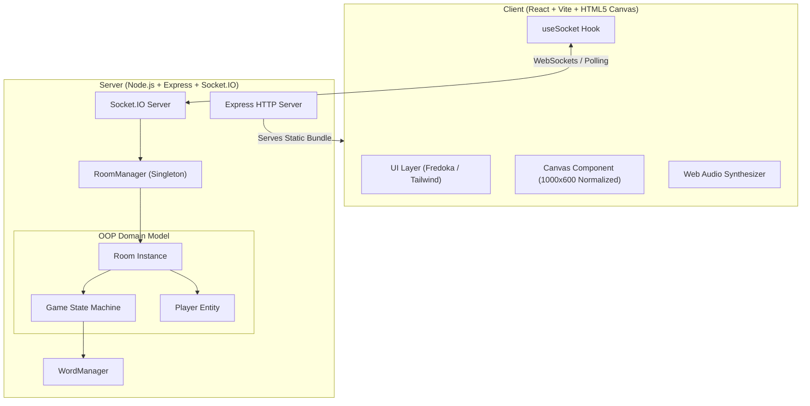

# 🏛️ Architecture & Engineering Design

This document details the architectural decisions, design patterns, state machines, and real-time synchronization mechanisms powering **DOODLR**.

---

## 1. High-Level Architecture Overview



---

## 2. Object-Oriented Domain Modeling (OOP Bonus Feature)

The server avoids procedural spaghetti code by encapsulating responsibilities into distinct domain classes:

### A. `Player` (`server/src/models/Player.ts`)
- Encapsulates player identity, socket connection status, cumulative score, round score, guess timing, and serialization (`toJSON()`).
- Methods: `addScore()`, `resetRound()`.

### B. `Game` (`server/src/models/Game.ts`)
- Manages the turn lifecycle state machine:
  $$\text{LOBBY} \xrightarrow{\text{start}} \text{SELECTING\_WORD} \xrightarrow{\text{select}} \text{DRAWING} \xrightarrow{\text{timeout / all guessed}} \text{ROUND\_END} \xrightarrow{\text{rounds done}} \text{GAME\_OVER}$$
- Owns the authoritative game timer (`setInterval` ticking at 1000ms intervals).
- Calculates speed-scaled points and drawer bonuses:
  $$\text{Guesser Points} = \text{round}\left(200 + 200 \times \frac{\text{timeLeft}}{\text{drawTime}} + \text{rankBonus}\right)$$
  $$\text{Drawer Bonus} = +50 \text{ pts per correct guess}$$
- Manages progressive letter hints and guarantees early round termination when all eligible guessers succeed.

### C. `Room` (`server/src/models/Room.ts`)
- Contains connected `Player` instances in a `Map<string, Player>`.
- Stores complete timestamped stroke history (`StrokeData[]`) for:
  1. Instant catch-up for newly joined or reconnected players.
  2. Undo functionality (`draw_undo`).
  3. **Priority 1: Round Replay** (saved in `roundReplays` map).
- Handles host migration: If the room host leaves, ownership dynamically transfers to the next connected player.

### D. `RoomManager` (`server/src/managers/RoomManager.ts`)
- Generates collision-free 6-character room codes excluding ambiguous characters (e.g. `O`, `0`, `I`, `1`).
- Provides room lookup, active room counts, and memory cleanup (`deleteRoom` destroys timers to prevent memory leaks).

---

## 3. Real-Time Drawing Synchronization

### Normalized Coordinate Space
To prevent drawing distortion across devices with different aspect ratios, DPR (Device Pixel Ratios), or screen sizes (mobile vs 4K monitor), the canvas uses a fixed logical coordinate space:
$$\text{Width} = 1000\text{px}, \quad \text{Height} = 600\text{px}$$

When a mouse or touch event occurs:
```typescript
const rect = canvas.getBoundingClientRect();
const scaleX = 1000 / rect.width;
const scaleY = 600 / rect.height;
const normalizedX = (clientX - rect.left) * scaleX;
const normalizedY = (clientY - rect.top) * scaleY;
```

### Event Streaming & Zero-Latency Rendering
1. **Local Drawing**: The active drawer renders immediately to their local `<canvas>` for zero input lag.
2. **Delta Emission**: Only coordinate deltas (`draw_start`, `draw_move`, `draw_end`) are transmitted over WebSockets.
3. **Remote Interpolation**: Non-drawers connect incoming point pairs with `ctx.lineTo()` using `round` line-caps and line-joins for smooth curves.
4. **Authoritative Server State**: Completed strokes are persisted on the server, ensuring that late-joining players and reconnection events redraw the canvas accurately.

---

## 4. Guessing, Matching & Security Architecture

### Zero-Knowledge Secret Word Privacy
- The secret word is stored **strictly on the server**.
- During the drawing phase, the server broadcasts masked hints (`_ _ _ _ _`) to guessers via `word_chosen` and `hint_update`.
- Only the socket connection belonging to the active drawer (`drawerId`) receives the plaintext secret word via the private `secret_word` event.

### Answer Normalization & Matching
Guesses are sanitized and compared:
```typescript
export function normalizeWord(text: string): string {
  return text
    .toLowerCase()
    .trim()
    .replace(/[^a-z0-9 ]/g, '')
    .replace(/\s+/g, ' ');
}
```

### Levenshtein Close Guess Detection
If a guess does not match exactly, the server computes the Levenshtein edit distance. If the guess is within 1–2 edits of the secret word, a private `'...' is very close!` notification is sent to the guesser without broadcasting the guess publicly.

---

## 5. Platform Constraints: Render vs Vercel/Netlify

| Platform | WebSocket Support | Suitability for Skribbl.io |
| :--- | :--- | :--- |
| **Render / Railway** | **Full Persistent WebSocket support** | **Ideal**: State is held in-memory across real-time room events. |
| **Vercel / Netlify** | Serverless functions only (HTTP requests timeout after 10–30s; no persistent WebSockets without external brokers like Pusher/Ably) | **Not recommended for direct Socket.IO server**. Can host frontend only if paired with a separate WebSocket backend. |
