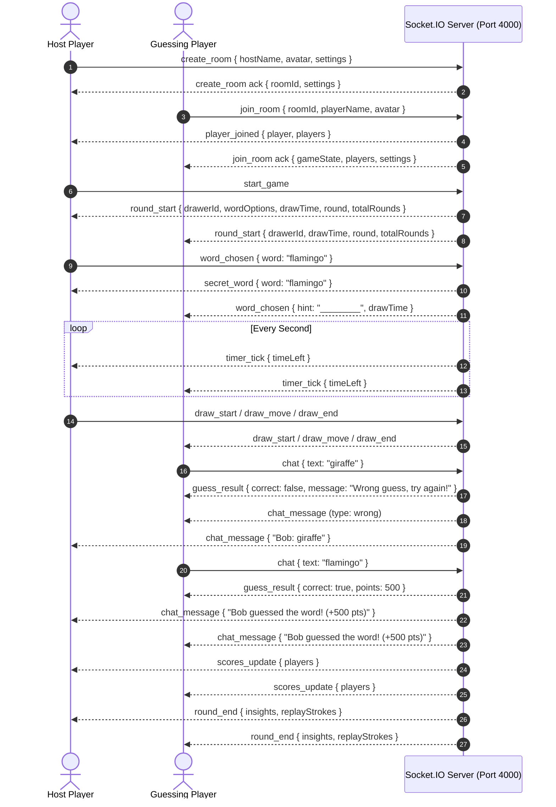

# 🎨 DOODLR — Real-Time Multiplayer Drawing & Guessing Game

> A full-stack, production-ready **Skribbl.io Clone** built with **React, TypeScript, Vite, Tailwind CSS, Node.js, Express, Socket.IO, and the HTML5 Canvas API**.

---

## 📖 Table of Contents
1. [Project Overview](#-project-overview)
2. [Key Features](#-key-features)
3. [Technology Stack](#-technology-stack)
4. [Screenshots](#-screenshots)
5. [Architecture & Real-Time Workflow](#-architecture--real-time-workflow)
6. [Environment Variables & Configuration](#-environment-variables--configuration)
7. [Local Installation & Setup](#-local-installation--setup)
8. [Available Scripts & Commands](#-available-scripts--commands)
9. [Automated Testing](#-automated-testing)
10. [Deployment Instructions (Render)](#-deployment-instructions-render)
11. [Future Improvements](#-future-improvements)

---

## 🌟 Project Overview

**DOODLR** is an interactive, multiplayer online drawing and word-guessing game inspired by Skribbl.io. Built with an authoritative client-server architecture, it enables 2 to 20 players to join a room via a 6-character room code or direct invitation link, take turns drawing words on a synchronized HTML5 canvas, and guess words in real-time chat with instantaneous speed scoring, progressive letter hints, and round replay capabilities.

---

## ✨ Key Features

### 1. Room Creation & Joining
- **Player Profiles**: Custom nickname selection with 12 playful animated avatars.
- **Configurable Settings**: Host can configure:
  - **Player Capacity**: 2 to 20 players (enforced strictly on server).
  - **Rounds**: 2 to 10 rounds per game.
  - **Drawing Time**: 15s (Blitz), 30s, 45s, 60s, 80s (Recommended), 100s, 120s, or 240s (Relaxed).
  - **Word Choices**: 1 to 5 selectable words per turn.
  - **Hints**: 0 (Disabled) to 5 progressive hints.
  - **Categories**: All, Animals, Food, Objects, Actions, Places.
  - **Word Modes**: Normal (standard blanks), Hidden (no letter reveals), and Combination (two-word phrases).
  - **Private Rooms**: Unlisted rooms accessible only via unique room code or shareable link.
- **Unique Room Codes**: 6-character clean codes (`ABCDEFGHJKLMNPQRSTUVWXYZ23456789`) excluding ambiguous characters.
- **Instant Invite Links**: 1-click clipboard link copying (`/?room=CODE`) with automatic code pre-fill on entry.

### 2. Turn-Based Game Lifecycle
- **Authoritative State Machine**: Seamless transitions across `LOBBY` ➔ `SELECTING_WORD` ➔ `DRAWING` ➔ `ROUND_END` ➔ `GAME_OVER`.
- **Fair Drawer Rotation**: Randomized player rotation ensuring each active participant draws once per round.
- **Secret Word Security**: Plaintext secret words are transmitted **exclusively** to the authorized drawer. Guessers receive masked hints (`_ _ _ _ _`).
- **Word Selection**: Drawer selects from 1–5 randomized choices with a 15-second countdown timer (auto-selects first option if timer expires).

### 3. Real-Time HTML5 Drawing Canvas
- **Resolution-Independent Coordinates**: 1000×600 normalized coordinate system ensuring pixel-perfect stroke synchronization across mobile, tablet, and high-DPI displays.
- **Pointer Events API**: Smooth tracking with `setPointerCapture` to eliminate dropped strokes when pointer drags outside canvas boundaries.
- **Drawing Tools**:
  - Pen / Brush tool with 4 sizes (S, M, L, XL).
  - 16 vibrant colors palette.
  - Dedicated Eraser tool.
  - Undo last stroke (`draw_undo`) and Clear canvas (`canvas_clear`).
  - Single-point click dot rendering.
- **Server Permission Enforcement**: Only the active drawer can emit drawing data; spectator strokes are rejected.

### 4. Guessing, Chat & Feedback
- **Answer Validation**: Case-insensitive, whitespace-trimmed, and special-character normalized string matching.
- **Speed-Decay Scoring**: Fastest guessers earn up to 500 points based on remaining time and guess rank.
- **Drawer Bonus**: Drawer earns bonus points for every player who guesses their drawing.
- **Cheating & Leak Prevention**: Drawer is prevented from typing the secret word or close variants in chat.
- **Friendly Feedback**:
  - **Correct Guess**: Broadcasts victory notice without leaking the secret word.
  - **Close Guess**: Uses Levenshtein distance to detect 1-character typos and privately sends `'... is very close!'`.
  - **Wrong Guess**: Displays guess in chat and provides a friendly `'Wrong guess, try again!'` prompt.

### 5. Priority Bonus Features
- **Round Replay (Priority 1)**: Every stroke is timestamped relative to round start. At round end, players can open the Replay Modal to watch the drawing animated chronologically with Play/Pause, Scrubber slider, and Speed multipliers (1x, 2x, 4x).
- **Round Insights (Priority 2)**: Comprehensive round-end breakdown displaying the revealed word, top scorer, correct guessers, time taken, and points awarded.
- **Multiplayer Reliability (Priority 3)**: Automatic host migration upon host departure, early round completion when all guessers succeed, and a 5-second disconnect grace period to handle brief network interruptions without losing player score.
- **Procedural Web Audio (Priority 5)**: Synthesized sound effects (timer ticks, correct guesses, game over fanfare) using the Web Audio API with zero external audio assets.

---

## 🛠️ Technology Stack

| Layer | Technology | Description |
| :--- | :--- | :--- |
| **Frontend** | React 18, TypeScript, Vite | Component tree, custom hooks, and reactive UI state |
| **Styling** | Tailwind CSS, Lucide React | Modern responsive design, typography, dark theme |
| **Canvas** | HTML5 Canvas API | 2D immediate-mode rendering with normalized coordinates |
| **Audio** | Web Audio API | Zero-asset procedural synthesizer for audio feedback |
| **Backend** | Node.js, Express | HTTP routing, REST endpoints, static production bundle serving |
| **Realtime** | Socket.IO (v4) | Low-latency bidirectional WebSocket communication |
| **Testing** | Node.js Test Runner (`node --test`) | Built-in test runner for high-speed unit & E2E tests |
| **Deployment** | Render (Blueprint) | Production hosting with persistent WebSocket support |

---

## 📸 Screenshots

> *Add application screenshots below once deployed or captured during local gameplay.*

| Home Screen & Room Setup | Live Lobby |
| :---: | :---: |
| *(Landing screen with nickname, avatar selection, and optional room settings drawer)* | *(Player list, crown host badge, room code copy button, and settings summary)* |

| Active Drawing & Guessing | Round Insights & Replay |
| :---: | :---: |
| *(HTML5 canvas, color palette, brush sizes, masked hint bar, and real-time chat)* | *(Revealed word, top scorer, time taken, points breakdown, and chronological stroke replay)* |

---

## 🏛️ Architecture & Real-Time Workflow



---

## ⚙️ Environment Variables & Configuration

The application uses standard environment variables. A template is provided in `.env.example`:

| Variable | Default (Local) | Production (Render) | Purpose |
| :--- | :--- | :--- | :--- |
| `PORT` | `4000` | Set dynamically by Render (`10000`) | Port on which Express and Socket.IO listen |
| `CORS_ORIGIN` | `*` | `*` or your production domain | Allowed origins for HTTP API and Socket.IO |
| `VITE_SERVER_URL` | *(Empty / `window.location.origin`)* | Same origin or backend URL | Backend URL when frontend is hosted separately |

Create a `.env` file in the root if you wish to override default local settings:
```env
PORT=4000
CORS_ORIGIN=*
```

---

## 🚀 Local Installation & Setup

### Prerequisites
- **Node.js**: `v18.0.0` or higher (tested on Node v22 and v24)
- **npm**: `v9.0.0` or higher

### Step-by-Step Setup
1. **Clone or navigate to the project directory**:
   ```bash
   cd "D:\aditi prsnl\Desktop\full stack task 2.pdf"
   ```

2. **Install all dependencies (Monorepo root, Server, and Client)**:
   ```bash
   npm run install:all
   ```

3. **Build the production bundles**:
   ```bash
   npm run build
   ```

---

## 💻 Available Scripts & Commands

| Command | Purpose |
| :--- | :--- |
| `npm start` | Starts the production server on port 4000 serving both API, WebSockets, and the client build |
| `npm run build` | Compiles both client (Vite) and server (TypeScript) bundles |
| `npm run build:client` | Compiles the React + Vite frontend into `client/dist` |
| `npm run build:server` | Compiles the backend TypeScript into `server/dist` |
| `npm run dev:server` | Runs TypeScript compiler in watch mode for the backend |
| `npm run dev:client` | Starts Vite hot-reloading development server on `http://localhost:5173` |
| `npm run dev` | Runs both backend watch compiler and Vite client concurrently |
| `npm test` | Runs the backend unit test suite using Node's native test runner |
| `node test_multiplayer.mjs` | Executes the 2-player end-to-end Socket.IO multiplayer verification test |

---

## 🧪 Automated Testing

### 1. Backend Unit Tests
Executes 13 unit tests verifying word matching, Levenshtein close-guess distance, hint generation, room bounds validation, and speed scoring:
```bash
npm test
```
**Expected Output**:
```text
✔ Word Matcher & Hint Generator Tests (5/5 passed)
✔ Room & Player Management Tests (3/3 passed)
✔ Drawing & Stroke Lifecycle Regression Tests (1/1 passed)
✔ Game Scoring & Rules Tests (2/2 passed)
✔ Room Configuration & Settings Tests (2/2 passed)
ℹ tests 13, suites 5, pass 13, fail 0
```

### 2. End-to-End Multiplayer Integration Test
Spins up two simulated Socket.IO clients to test:
- Room creation with custom settings (15s draw time, 4 word choices, animals category).
- Player joining and capacity checks.
- Host authorization enforcement (non-host cannot start game or update settings).
- Word choices delivery and masked hint broadcast.
- Real-time drawing stroke transmission.
- Incorrect guess evaluation and friendly feedback delivery.
- Correct guess scoring and broadcast announcement.
- Player disconnection and reconnection with score preservation.

```bash
# Ensure server is running on port 4000 (npm start), then execute:
node test_multiplayer.mjs
```

---

## 🚢 Deployment Instructions (Render)

This repository includes a production-ready `render.yaml` blueprint.

### 1-Click Render Deployment:
1. Push your repository to GitHub.
2. Sign in to the [Render Dashboard](https://dashboard.render.com).
3. Click **New +** ➔ **Blueprint**.
4. Connect your GitHub repository.
5. Render detects `render.yaml` and provisions:
   - **Environment**: Node.js
   - **Build Command**: `npm install && npm install --prefix server && npm install --prefix client && npm run build`
   - **Start Command**: `npm start`
   - **Health Check Path**: `/health`
6. Once deployed, Render provides an HTTPS URL (e.g. `https://doodlr-skribbl-clone.onrender.com`).

---

## 🔮 Future Improvements

1. **Persistent Account & Stats**: Integration with PostgreSQL/Prisma or MongoDB for persistent player profiles, total games won, and global ranking.
2. **WebRTC Voice Chat**: Proximity or room-wide peer-to-peer audio communication.
3. **Flood Fill (Bucket Tool)**: 4-way flood-fill algorithm on canvas bitmap for rapid region coloring.
4. **Custom Word Pack Creator**: Community-submitted word packs with import/export capabilities.
5. **Spectator Mode**: Allow unlimited spectators beyond the 20 active drawer/guesser slots.

---

## 📄 License
This project was built for an engineering internship assessment. MIT License.
